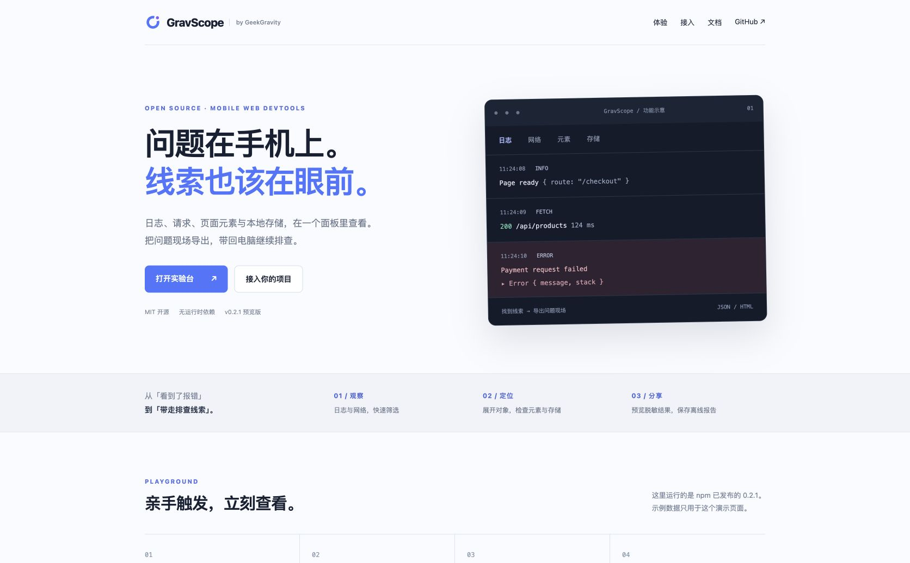
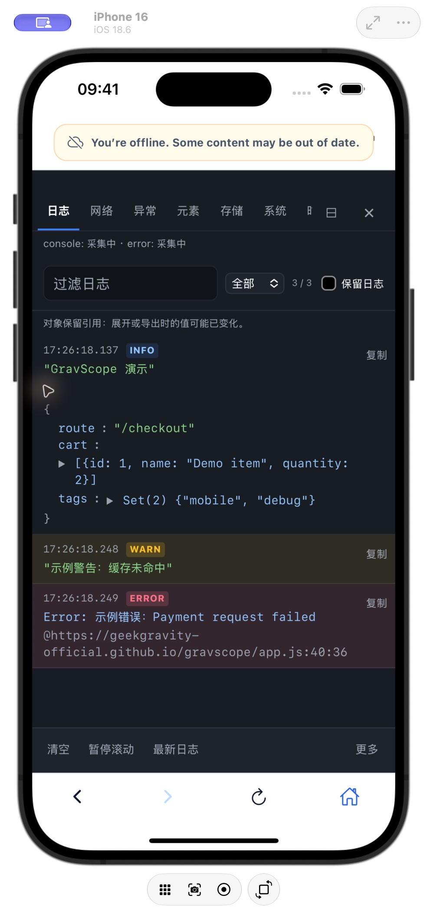

# GravScope

[Website & Playground / 官网与在线体验](https://geekgravity-official.github.io/gravscope/)

**Mobile web debugging, by GeekGravity.**

[简体中文](README.zh-CN.md) · [Contributing](CONTRIBUTING.md) · [Changelog](CHANGELOG.md)

Inspect logs, requests, page elements and storage directly on a mobile web page. Export a diagnostic snapshot as a standalone HTML report or JSON to share a reproducible starting point with your team.

GravScope is an independent implementation, not a fork or drop-in replacement of vConsole.

## Preview

Website and live console screenshots from v0.2.1. [Try the playground](https://geekgravity-official.github.io/gravscope/).



Mobile console · iPhone 16 / iOS 18.6 simulator, inside GeekGravity

<p align="center">
  
</p>

## Status

**0.2.1 is an early preview.** Automated checks cover core behavior and package entry points. Mobile browser/device validation and long-running performance testing remain open.

## Features

- Console capture, uncaught errors, level filters, search, repeat counts and expandable values.
- Fetch, XMLHttpRequest, sendBeacon and resource diagnostics with request search.
- DOM tree inspection, element picking and highlighting.
- Cookie, localStorage and sessionStorage viewing and editing.
- System information and custom fields.
- Collapsible JavaScript command input and custom plugins.
- Light, dark and system themes, Shadow DOM style isolation, resizable/full-screen panel.
- Diagnostic exports with preview, time range selection and heuristic credential redaction.
- No runtime package dependencies; separate modern and compatibility builds.

## Quick start

Install from npm:

```sh
npm install @geekgravity/gravscope
```

```ts
import GravScope from '@geekgravity/gravscope/modern';

const panel = new GravScope({ theme: 'auto' });
console.log('Hello GravScope', { ready: true });

// Remove the panel and release owned capture hooks.
panel.destroy();
```

Use `@geekgravity/gravscope` for the ES5-syntax build with language polyfills. Neither build is a guarantee of support for a particular WebView: Shadow DOM, CSS variables and other browser APIs still matter. Test your target devices.

For a script tag, build or unpack the package and serve `dist/gravscope.modern.iife.js` (or `dist/gravscope.iife.js`). Its global constructor is `GravScope`.

Enable only in development or controlled testing environments. The command input executes JavaScript in the page context. Do not enable it by default for end users.

## Configuration and API

```ts
const panel = new GravScope({
  theme: 'auto', // 'light' | 'dark' | 'auto'
  lang: 'en', // 'en' | 'zh'; defaults to browser language
  defaultPlugins: ['network', 'errors', 'element', 'storage', 'system', 'timeline', 'performance', 'streams'],
  maxLogNumber: 1000,
  maxNetworkNumber: 200,
  entryButton: true,
  exportEnabled: true,
});

panel.show();
panel.hide();
panel.showTab('network');
panel.setOption('theme', 'dark');
panel.setOption('maxLogNumber', 500);
panel.setSystemInfo('Build', 'preview-1');
panel.destroy();
```

All initialization options are optional. `new GravScope()` uses the defaults below. The panel starts closed, while capture begins during initialization.

| Option | Type | Default | Description |
| --- | --- | --- | --- |
| `theme` | `'light' / 'dark' / 'auto'` | `'auto'` | Panel theme; auto follows changes to the system color preference. |
| `lang` | `'zh' / 'en'` | `自动检测 / Auto-detect` | Uses Chinese when navigator.language starts with zh, otherwise English. |
| `defaultPlugins` | `BuiltinPlugin[]` | `['network', 'errors', 'element', 'storage', 'system', 'timeline', 'performance', 'streams']` | Adds panels in array order; Errors, Timeline, Performance and Streams are available since 0.2.0; duplicates and unknown names are ignored. Log is always included; pass [] for Log only. |
| `capture` | `Partial<CaptureOptions>` | `{ console: true, network: true, error: true, navigation: true, performance: true, realtime: true }` | Since 0.2.0: independent capture channels; supports partial runtime updates. |
| `preserveLogs` | `boolean` | `false` | Since 0.2.0: retain sanitized logs across reloads; omission reuses the session toggle. See below. |
| `maxLogNumber` | `number` | `1000` | Maximum retained log records; oldest records are evicted. This is a record count, not a byte limit. |
| `maxNetworkNumber` | `number` | `200` | Maximum retained network records; oldest records are evicted. |
| `entryButton` | `boolean` | `true` | Shows the floating entry button. With false, open the panel through show() or showTab(). |
| `exportEnabled` | `boolean` | `true` | Shows the log toolbar export entry. false hides access to the report preview, copy and download controls; getReport() and the separate log-copy tool remain available. |
| `target` | `HTMLElement / string / null` | `null → document.body` | Mount element or CSS selector. At mount time the selector must match an HTMLElement or an error is thrown. Omit or pass null to use body. |
| `networkIgnore` | `string[]` | `[]` | Since 0.2.0: case-sensitive URL substrings excluding future requests/new realtime connections; runtime replacement supported. |
| `redactKeys` | `string[]` | `[]` | Since 0.2.0: additional case-insensitive exact field names for report/history masking; runtime replacement supported. |
| `onExport` | `(file: ExportFile) => void \| Promise<void>` | `undefined` | Since 0.2.0: take over HTML/JSON export. Initialization only; omission preserves browser downloads. |
| `onReady` | `() => void` | `undefined` | Called once after the UI mounts, with no arguments. Does not wait for page resources or requests. |

Use positive integers for both record limits. During initialization, fractions are rounded down (with a minimum effective limit of 1); zero, negatives, NaN, Infinity and non-numbers fall back to the respective default. Reducing a limit immediately evicts excess old records.

`defaultPlugins` selects panels, not capture hooks. Hiding the entry button, export UI or panel does not stop capture. Call `destroy()` to release hooks owned by the instance. Only one instance can be active at a time; access it through `GravScope.current`.

### Custom entry and export controls

```ts
const panel = new GravScope({
  lang: 'en',
  defaultPlugins: ['network', 'system'],
  entryButton: false,
  exportEnabled: false,
});
// Call from your own debug button's click handler:
panel.show();
// Or open a specific enabled panel:
panel.showTab('network');
```

### Mount target and readiness

```ts
// First provide <div id="debug-root"></div> in the page.
const panel = new GravScope({
  target: '#debug-root', // An HTMLElement is also accepted.
  onReady() {
    GravScope.current?.show();
  },
});
```

`target` changes the mount location; the UI remains an overlay rather than normal content inside that container. When using the default body target before body exists, mounting waits for DOMContentLoaded.

**`onReady` can run synchronously before the constructor returns.** Do not reference the not-yet-assigned `panel` variable inside this callback; use `GravScope.current`. Exceptions thrown by the callback are recorded as logs.

### Changing options after initialization

`setOption()` currently supports only `theme`, `maxLogNumber`, `maxNetworkNumber`, `entryButton`, `preserveLogs`, `capture`, `networkIgnore` and `redactKeys` (new diagnostic options are available since 0.2.0). To change language, mount target or export settings, destroy and recreate the instance; previous records are not retained by default; preserveLogs can restore a bounded historical snapshot. Use `addPlugin()` / `removePlugin()` to manage plugins.

## API reference

Examples assume `const panel = new GravScope()` already exists. Methods are synchronous; `void` means no return value, no chaining and no Promise.

### `show()`

Parameters: None.

Returns: `void`。

Opens the panel and resets the unread count without clearing logs.

```ts
panel.show();
```

### `hide()`

Parameters: None.

Returns: `void`。

Closes the panel; capture continues.

```ts
panel.hide();
```

### `showTab(id)`

Parameters: id: string, the ID of an added panel.

Returns: `void`。

Activates a tab and opens the panel. Built-in IDs: log, network, errors (0.2.0), element, storage, system, timeline, performance, streams (new diagnostics are available since 0.2.0); custom tabs use plugin.id. An unknown ID leaves the active tab unchanged but still opens the panel.

```ts
panel.showTab('network');
```

### `setOption(key, value)`

Parameters: key: 'theme', value: 'light' / 'dark' / 'auto'; or key: 'maxLogNumber' / 'maxNetworkNumber', value: number; or key: 'entryButton' / 'preserveLogs', value: boolean; or key: 'capture', value: Partial<CaptureOptions>; or key: 'networkIgnore' / 'redactKeys', value: string[]. New diagnostic options are available since 0.2.0.

Returns: `void`。

Updates theme, capacity or the floating entry immediately. Runtime limits are rounded down and clamped to at least 1; non-finite values are ignored (unlike initialization defaults). Invalid themes are ignored. Also accepts preserveLogs (boolean) and capture (Partial<CaptureOptions>), both available since 0.2.0. Only documented keys are supported; lowering a limit evicts old records immediately. Runtime entryButton support is available from 0.1.2. false hides the entry immediately; true shows it only while the panel is closed. It does not close the panel or stop capture. Non-boolean values are ignored.

```ts
panel.setOption('theme', 'dark');
panel.setOption('maxLogNumber', 500);
panel.setOption('maxNetworkNumber', 100);
// hide / restore the floating entry
panel.setOption('entryButton', false);
panel.setOption('entryButton', true);
```

### `setSystemInfo(key, value)`

Parameters: key: string, information label; value: string, display value.

Returns: `void`。

Adds or replaces custom system information by key, also included in report.custom. The System panel need not be open.

```ts
panel.setSystemInfo('Build', '2026.11.04');
panel.setSystemInfo('Environment', 'staging');
```

### `getReport(options?)`

Parameters: options?: ReportOptions, defaults to {}; fields below.

Returns: `DiagnosticReport`。

Synchronously returns a redacted snapshot without downloading, uploading or opening a dialog. Available when exportEnabled is false. Throws if since is non-finite or negative, the JSON report exceeds 5 MiB, or filtered logs/requests exceed 10000 each.

```ts
const report = panel.getReport({
  since: Date.now() - 5 * 60 * 1000,
  includeBodies: false,
});
const json = JSON.stringify(report, null, 2);
```

### `addPlugin(plugin)`

Parameters: plugin: GravScopePlugin, configured with handlers and tools.

Returns: `void`。

Adds a tab and synchronously emits init and render. IDs must be unique; conflicts with built-in or custom plugins throw. Does not automatically select the new tab.

```ts
const plugin = new GravScope.Plugin('build', 'Build');
plugin.on('render', element => {
  element.textContent = 'Build 2026.11.04';
});
panel.addPlugin(plugin);
panel.showTab('build');
```

### `removePlugin(id)`

Parameters: id: string, plugin ID to remove.

Returns: `void`。

Emits remove and removes the tab; unknown IDs are ignored. Removing the active tab selects the first remaining tab. If a remove handler throws, the tab is still removed and the error propagates. Removing Network does not stop capture.

```ts
panel.removePlugin('build');
```

### `destroy()`

Parameters: None.

Returns: `void`。

Removes the UI, emits plugin remove, releases owned capture hooks and listeners, and clears GravScope.current. Safe to repeat; plugin cleanup errors do not block teardown. Create a new instance to start again.

```ts
panel.destroy();
const nextPanel = new GravScope();
```

### `getReport` options and result

| Option | Type | Default | Description |
| --- | --- | --- | --- |
| `since` | `number` | `0` | Unix milliseconds; includes logs and requests at or after this time (request start time). Not seconds or a duration. |
| `redactKeys` | `string[]` | `[]` | Since 0.2.0: additional keys for this report; merges with instance keys without changing configuration. |
| `includeBodies` | `boolean` | `false` | Includes already captured request/response bodies and realtime message content, still subject to truncation and redaction; does not recover uncaptured data. |

| Result field | Type | Description |
| --- | --- | --- |
| `schemaVersion` | `1` | Report schema version. |
| `version` | `string` | GravScope library version. |
| `createdAt` | `string` | Creation time as an ISO 8601 string. |
| `page` | `string` | Redacted current page URL. |
| `device` | `{ userAgent: string; language: string; viewport: string }` | Browser, language and viewport information. |
| `custom` | `unknown` | Redacted custom system information. |
| `logs` | `unknown[]` | Retained logs within the time range. |
| `activity` | optional `unknown[]` | Since 0.2.0: retained navigation, long-task and realtime activity within the time range; absent in older reports. |
| `network` | `unknown[]` | Retained requests within the time range. |
| `policy` | `string` | Capture and redaction policy. |

Contents of `custom`, `logs` and `network` are sanitized and bounded; narrow their types before use rather than treating them as raw objects. Capture reports before calling `destroy()`.

### Public properties

| Property | Type and purpose | Example |
| --- | --- | --- |
| `GravScope.current` | `GravScope / null` — Current instance; null before initialization or after destruction. Read without assigning. | `GravScope.current?.show()` |
| `GravScope.version` / `panel.version` | `string` — Read-only library version. | `console.log(GravScope.version)` |
| `GravScope.Plugin` | `typeof GravScopePlugin` — Plugin constructor, also available through the CDN global. | `new GravScope.Plugin('build', 'Build')` |

## Preserve logs across reloads (0.2.0)

Enable **Preserve logs** in the log filter bar, or configure it through initialization / the runtime API:

```ts
const panel = new GravScope({ preserveLogs: true });
panel.setOption('preserveLogs', false); // Stop saving and delete the session archive.
panel.setOption('preserveLogs', true);  // Save retained logs and subsequent updates.
```

Off by default. When omitted, the option reuses the last toggle state in this tab session. Explicit false disables it and deletes the archive. Hiding the panel does not stop saving; destroy flushes the last snapshot and releases listeners.

- Uses same-origin sessionStorage for reloads and navigation within a tab, not localStorage. Browser session restoration or tab duplication may retain/copy sessionStorage; behavior depends on the browser.
- Retains at most the latest 200 records, also bounded by maxLogNumber. The serialized JSON is limited to 131072 UTF-16 code units (about 256 KiB); oldest records, including an individually oversized record, may be dropped.
- Saves sanitized static log/error snapshots, excluding command source, network records and local storage. Heuristic redaction cannot identify all business-sensitive text.
- Restores original timestamps, group relationships and collapse state, adds History badges and a new-page separator. New logs do not inherit an unfinished group from the previous page.
- Clear / console.clear() clears both current and saved logs, retaining the toggle preference. Disabling preservation deletes the archive without clearing current logs.
- Writes are coalesced over 150ms and flushed on page hiding, pagehide, the reload tool and destroy. Forced termination may lose unsaved records. Disabled/full storage can prevent restoration but does not interrupt capture.

## Debugging workflow additions (0.2.0)

These additions are available since 0.2.0.

### Network filters and copying

Combine URL search, all/request/static/failed categories, method and status filters. Status accepts exact codes such as `404`, ranges such as `4xx`, or `pending`. Details offer separate URL, request headers/body and response headers/body copying. cURL uses POSIX shell quoting and HTTP(S) URLs only. It uses captured data, may contain credentials, and cannot fully reproduce binary, streamed or truncated request bodies.

### Pause scrolling and Errors panel

**Pause scrolling** keeps your reading position while capture continues. The new-record button or **Latest** resumes following. Repeat updates count as new activity; scrolling upward also stops automatic following.

The default `errors` panel groups JavaScript exceptions, unhandled Promise rejections, resource failures and console.error by source and full text. Search, source filtering and stack copying are available. **Clear errors** removes those errors from Log too, preserving normal logs. Errors share the maxLogNumber retention limit. Errors are paged in groups of 100; search covers all retained errors. Large-store updates are batched, and expanded stacks stay open while their cards remain on the current page. Changing pages or filters can reset expansion.

```ts
panel.showTab('errors');
```

### Capture channels

Use **Capture settings** in the Log toolbar, or the API:

```ts
const panel = new GravScope({
  capture: { console: true, network: false, error: true },
});
panel.setOption('capture', { network: true });
panel.setOption('capture', { console: false, error: false });
```

`capture` is `Partial<CaptureOptions>`: console/network/error/navigation/performance/realtime booleans, all true by default. Runtime updates merge only supplied boolean fields; other channels remain unchanged and non-booleans are ignored. Returns void.

Disabling a channel preserves existing records and releases its hooks. Disabling Network does not abort page requests; unfinished diagnostic records are marked Capture stopped. Re-enabling captures new activity without backfilling the disabled interval. console.error belongs to the console channel; global errors, Promise rejections and resource failures belong to error. Network failures are independent. With Console disabled, the panel Clear tool still works, but page console.clear() no longer clears the panel. Capture settings are not persisted across reloads and are independent of preserveLogs.

### Report import and replay

The website viewer accepts file selection or drag-and-drop of schemaVersion 1 JSON reports. Search Logs, Errors, Network and Activity locally, retaining log group relationships. Read-only: no code execution, request replay or file uploads. Limits: 5 MB per file, 10000 logs, 10000 requests and 1000 activity records, 100 displayed at a time with a load-more button, 20000 characters per detail preview. Clear or closing the page releases the report; invalid imports clear the previous display. Supports reports exported by 0.1.2, including logs whose group headings have been evicted.

## Diagnostic reports

Set `exportEnabled: false` during initialization to hide the export UI (default: `true`). This is a UI preference; `getReport()` remains available.

Choose **More → Export** in the log toolbar. **Copy report** copies the redacted JSON preview; **Select all** supports manual copying when WebView clipboard APIs are unavailable. Preview all retained records or the last five minutes, then save HTML or JSON. The HTML report opens offline without external resources or executable report data. If downloading is unsupported, copy the preview manually.

```ts
const snapshot = panel.getReport({
  since: Date.now() - 5 * 60 * 1000,
  includeBodies: false,
});
```

Request/response bodies are excluded by default. Storage and command source are excluded. Common credential fields and URL query values/fragments are masked. **Redaction is heuristic: inspect the preview before sharing.** Arbitrary business-sensitive strings may remain.

Only retained data is exported, not a session recording or complete history. Object values reflect export time. Depth, property, node and string limits apply.

## Plugins

```ts
import { GravScopePlugin } from '@geekgravity/gravscope/modern';

const plugin = new GravScopePlugin('build', 'Build');
plugin.on('render', element => {
  element.textContent = 'Build preview-1';
});
plugin.addTool('Refresh', () => console.info('Refresh requested'));
panel.addPlugin(plugin);
panel.removePlugin('build');
```

### Plugin API

#### `new GravScopePlugin(id, name)`

Parameters and behavior: id: string, nonempty unique ID; name: string, tab label, falls back to id when empty.

Returns: `GravScopePlugin`.

```ts
const plugin = new GravScope.Plugin('build', 'Build');
```

#### `on(event, handler)`

Parameters and behavior: event is a name from the event table; handler is the corresponding callback. Adds a listener without replacing previous handlers.

Returns: `this`; `this` supports chaining.

```ts
plugin.on('render', element => { element.textContent = 'Ready'; });
```

#### `addTool(name, onClick, options?)`

Parameters and behavior: name: string, button label; onClick: () => void, click callback with no arguments. Optional options: { placement?: 'primary' | 'more' }, default primary; more moves the tool into the overflow menu (0.2.0).

Returns: `this`; `this` supports chaining.

```ts
plugin.addTool('Refresh', () => console.info('Refresh requested'));
```

#### `getTools()`

Parameters and behavior: None. Returns a shallow copy of the tools array; button objects remain shared and should not be mutated.

Returns: `Array<{ name: string; onClick: () => void }>`.

```ts
const labels = plugin.getTools().map(tool => tool.name);
```

#### `emit(event, ...args)`

Parameters and behavior: event is an event name; render requires an HTMLElement, others take no arguments. Calls handlers synchronously in registration order; exceptions interrupt and propagate. Normally dispatched by the panel; manual emission does not change UI state.

Returns: `void`.

```ts
// Manual handler invocation only; does not open the tab.
plugin.emit('show');
```

| Event | Handler | Timing |
| --- | --- | --- |
| `init` | `() => void` | Runs on plugin addition, before render. |
| `render` | `(element: HTMLElement) => void` | Runs on addition; populate the provided panel element. |
| `show` | `() => void` | Emitted on tab activation or panel show; may repeat and does not guarantee actual visibility. |
| `hide` | `() => void` | Emitted when leaving a tab or hiding the panel; may repeat. |
| `remove` | `() => void` | Use to clean up owned timers/listeners on removePlugin or destroy. |

Register handlers and tools before `addPlugin()`. The toolbar reads tools on tab activation; adding tools does not immediately redraw an active toolbar. `id` and `name` are read-only strings; an empty id throws during construction. There is no `off()` API; clean up listeners and timers owned by your plugin in `remove`.


## Capture limits

- Teardown restores hooks only when they are still owned by GravScope, preserving wrappers installed later.
- Fetch preview failures do not reject a successful host request. Pending requests stop updating the panel after teardown.
- Fetch previews read up to approximately 100 KB. Truncated sizes describe sampled bytes, not the complete response. SSE bodies are not buffered.
- Without stream-reading APIs, only small responses with a declared size are considered for preview.
- Log/network retention is bounded. A 10,000-record store test verifies capacity, not real-device rendering speed.
- Initialization failures clean up registered hooks and allow a new instance.

The log toolbar includes **Reload page**, which performs a normal reload and resets in-memory logs. Packaged `.map` files remain available for manual debugging, without automatic source map requests.

## Toolbar and large log lists (0.2.0)

The Log toolbar keeps Clear, Pause scrolling and Latest visible. Copy, Console, Export, Reload page and Capture settings move into More. Outside clicks, Escape and choosing an action close the menu.

Above 200 retained records, logs render in pages of 200 plus at most 100 group-context rows. Earlier / Newer navigate the pages. Incoming updates are coalesced over about 16ms; this is paged rendering, not continuous fixed-height virtual scrolling. Pausing or browsing older pages pins the current page; Latest returns to the tail. Expanded objects stay open while their nodes remain in the current window, and are rebuilt after leaving it.

Search covers all retained records. Copy respects filtering/folding across all matching records, not just the displayed page. maxLogNumber still controls data retention; paging does not delete data. The 10000-record DOM test is not a device frame-rate or memory benchmark; see the [mobile validation checklist](docs/mobile-validation.md).

Custom plugins may place secondary tools in More. By default at most three tools remain primary; others overflow:

```ts
plugin.addTool('Secondary action', () => console.info('action'), { placement: 'more' });
```

## Local development

Use Node.js 22.12+ and npm.

```sh
npm ci
npm run dev
npm run typecheck
npm test
npm run build
npm run check:package
```

Open the local URL printed by Vite. Add `?shot` to populate sample data. This sample deliberately triggers an error and a failed resource request.

`npm pack` produces a tarball that can be installed with `npm install /path/to/geekgravity-gravscope-0.2.1.tgz` for local evaluation.

## License

[MIT](LICENSE).

## CDN

jsDelivr (pinned version / 固定版本):

```html
<script src="https://cdn.jsdelivr.net/npm/@geekgravity/gravscope@0.2.1/dist/gravscope.modern.iife.js"></script>
<script>const panel = new GravScope();</script>
```

[UNPKG fallback / 备用地址](https://unpkg.com/@geekgravity/gravscope@0.2.1/dist/gravscope.modern.iife.js).

## Extended diagnostics and export integration (0.2.0)

The new default panels are `timeline`, `performance`, and `streams`. Error context opens a ±30-second timeline of retained logs, requests, navigation and activity; time proximity does not prove causation. Network renders at most 100 rows per page. Storage supports key/value search, explicit save/cancel, JSON formatting/validation, and deletion confirmation.

Performance ranks completed requests taking at least 1000 ms (top 50), known resource/preview sizes (top 50), and new long tasks where the browser supports them. Sizes are not guaranteed transfer sizes; long tasks can include debugger overhead.

Realtime capture observes new WebSocket/EventSource connections, WS sent/received messages, SSE default messages and named events registered through the observed instance (up to 100 names per connection). Text is capped at 2000 characters; binary is represented by size only. Activity shares a 1000-record bound independently of log/network capacity. Existing connections, workers, other frames and fetch-based SSE message bodies are not captured. Disabling capture never closes page-owned connections; re-enabling observes new connections only.

```js
const panel = new GravScope({
  networkIgnore: ['/heartbeat', '/analytics'],
  redactKeys: ['phone', 'customerId'],
  capture: { navigation: true, performance: true, realtime: true },
});
panel.setOption('networkIgnore', ['/heartbeat']);
panel.setOption('redactKeys', ['phone', 'customerId']);
panel.setOption('capture', { realtime: false });
```

Rules are replaced, not appended. Up to 100 nonempty strings of at most 100 characters are accepted; other entries are ignored. URL exclusion is case-sensitive substring matching, not regex; it affects future requests/new connections, not existing retained data. Custom redaction matches exact object/JSON field names case-insensitively and attempts plain `key=value`/`key:value` masking. It applies to reports and persisted history, not live data, raw copying or cURL. `getReport({ redactKeys: ['extraField'] })` adds per-export keys to the instance rules. Built-in masking remains enabled. Activity is available in JSON/HTML reports and the website viewer; message bodies are excluded unless includeBodies is true.

### onExport

```ts
import type { ExportFile, ExportHandler } from '@geekgravity/gravscope';
// ExportFile: { requestId: string; filename: string; mimeType: string;
//               format: 'html' | 'json'; content: string }
```

```js
new GravScope({
  async onExport(file) {
    // appBridge is your application's integration, NOT a browser/GravScope API.
    // Its Promise must resolve/reject on the native completion/failure callback.
    await window.appBridge.saveDiagnosticFile({
      requestId: file.requestId, filename: file.filename, mimeType: file.mimeType, content: file.content,
    });
  },
});
```

The callback receives sanitized text, not a Blob, Base64 or file path. Filename: `gravscope-<report timestamp>.html`/`.json`; MIME: `text/html;charset=utf-8`/`application/json;charset=utf-8`. The native host writes UTF-8 and implements saving/sharing. Extensions do not enable downloads in a WebView by themselves.

Omit onExport for the default Blob download. Providing it fully takes over the two file-export buttons; no automatic download or upload occurs. Return void or Promise<void>; throw/reject to show failure and allow retry. There is no boolean fallback contract. An instance-level pending task disables both export buttons even after the dialog is reopened; task ID and filename remain visible. Callback completion is not proof of native saving unless your bridge waits for that result. Closing the dialog does not cancel an in-flight native operation; after 30 seconds the UI offers a long-wait notice. Confirming Cancel waiting releases the component task only; native work may still continue, and a retry may duplicate it. Late completions cannot overwrite a new task. True native cancellation and cross-instance deduplication remain the host’s responsibility.

Initialization only; there is no setOption('onExport'). getReport(), copying and manual text selection do not invoke it. exportEnabled:false hides the entry but retains getReport(). Native postMessage APIs need an application-level request/acknowledgement protocol; message transmission alone does not confirm a saved file. The application handles size limits, chunking, encoding, or any intentional upload.

See [diagnostic details](docs/diagnostics.md) and [export integration guide](docs/export-integration.md) (Chinese). New APIs are available since 0.2.0. iOS simulator WKWebView smoke checks passed; physical-device and long-session validation remain open. Native file saving is implemented and validated by each integrator.

### Reliability and clearing all diagnostics (0.2.0)

`panel.clearAll(): void` clears retained logs, requests, activity, custom system info and persisted log records, and dismisses an open report preview. It preserves capture/history settings, page storage and page-owned connections. It does not cancel an export already handed to the application. The More menu asks for confirmation; the API does not. Calls after destroy are no-ops. Existing per-panel Clear buttons retain their narrower scope.

JSON preview shows UTF-8 byte size; exports are limited to 5 MiB, with a separate actual-size check for HTML after escaping. getReport() also applies a size budget and the viewer's 10000-log/10000-request limit after time filtering. Failure throws an Error named ReportLimitError or shows a UI explanation; no partial report, download or callback is produced. Narrow the range, exclude bodies, or clear records to retry. Native bridges may impose a lower limit.

Capture installation failures roll back the affected channel, keep other channels usable, and show a warning/status with retry in Capture settings. Fundamental mount/configuration errors still fail initialization. The log panel explicitly reminds users that logged objects are live references, not logging-time snapshots. Mobile/native behavior remains subject to device acceptance.

### Capture status and release checks (0.2.0)

`panel.getCaptureStatus(): CaptureStatusMap` takes no arguments and returns a detached map for all six channels. Each entry contains `enabled: boolean`, `state: 'enabled' | 'disabled' | 'unavailable' | 'failed'`, and localized `detail: string`. Unavailable means missing platform support; failed means hook/subscription installation failed. Retry via setOption('capture', ...). Mutation of the result does not affect capture, and destroyed instances report disabled channels.

Panel banners show channel states; Capture settings explains coverage. Streams explicitly observe new connections only. Unsupported long-task APIs are not shown as actively collecting; absence of records does not prove absence of activity.

`npm run check:release` checks package/lock/runtime versions and pinned website CDN references. Strict publish checks reject unpromoted Unreleased notes and package/website version mismatches. After build, `npm run check:soak -- 1` runs a one-minute synthetic capture/lifecycle check; use `-- 30` for thirty minutes. This uses Node/happy-dom and fake connections, not a real mobile browser/native bridge.

## iframe boundaries (0.2.1)

Each instance captures its own window, is clipped to its frame and reloads that frame only. Session history is isolated by position in a stable frame tree, including parents, siblings and nested children. Dynamic insertion, removal, reordering or position reuse may restore the old slot's history; avoid preserveLogs in those cases. No cross-frame aggregation. See [diagnostics and validation](docs/diagnostics.md).

Native file saving, sharing and permissions remain the integrator's responsibility.

## Basic page performance (0.2.1)

Performance and System show the same navigation/paint metrics: redirects, DNS, connection, TLS, request/navigation TTFB, document download, DOM interactive, DOMContentLoaded, Load, FP/FCP and document transfer/encoded/decoded sizes. Search/copy, JSON/HTML export and local replay include these measurements.

```js
const report = panel.getReport();
const load = report.performance?.metrics.load;
if (load?.state === 'available') console.log(load.value, load.unit);
```

Each metric has `value: number | null`, `unit: 'ms' | 'bytes'`, and `state: 'available' | 'pending' | 'unavailable'`. Zero is a valid observation; missing values are null. Load is not application readiness. These are current-document timings, not SPA route or BFCache restoration timings. Standard LCP/CLS/INP scores are not included. See [metric semantics](docs/diagnostics.md).
